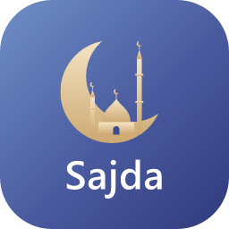
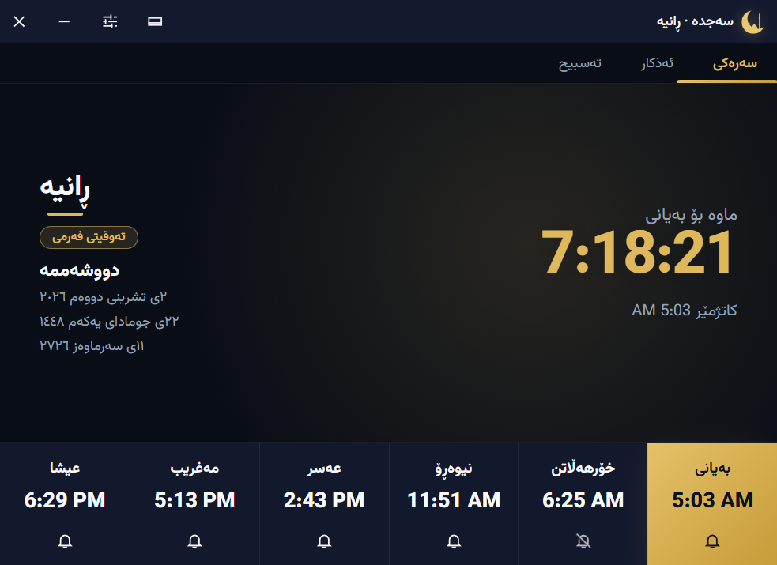
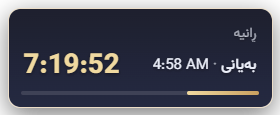
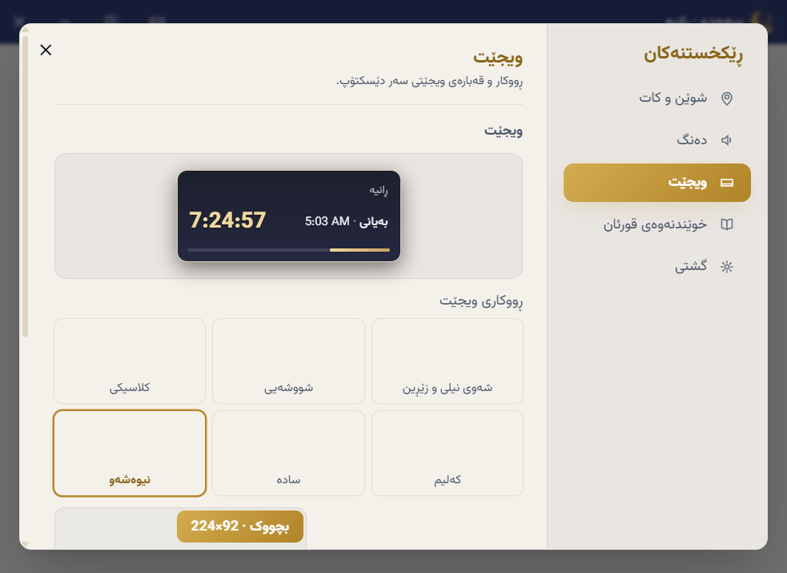
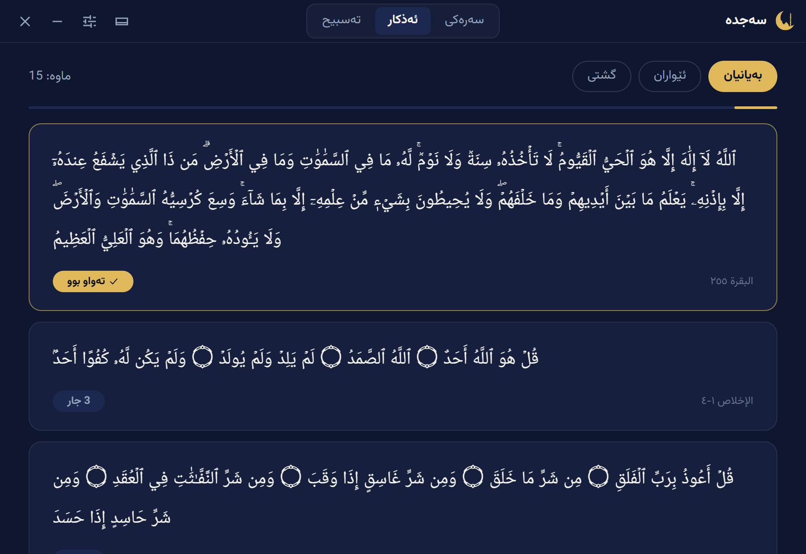
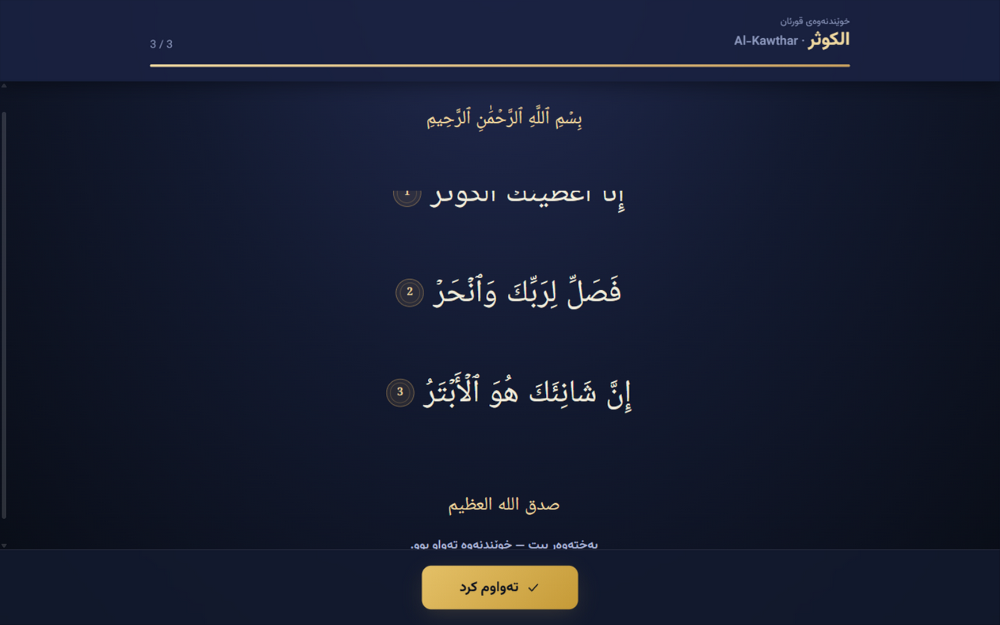
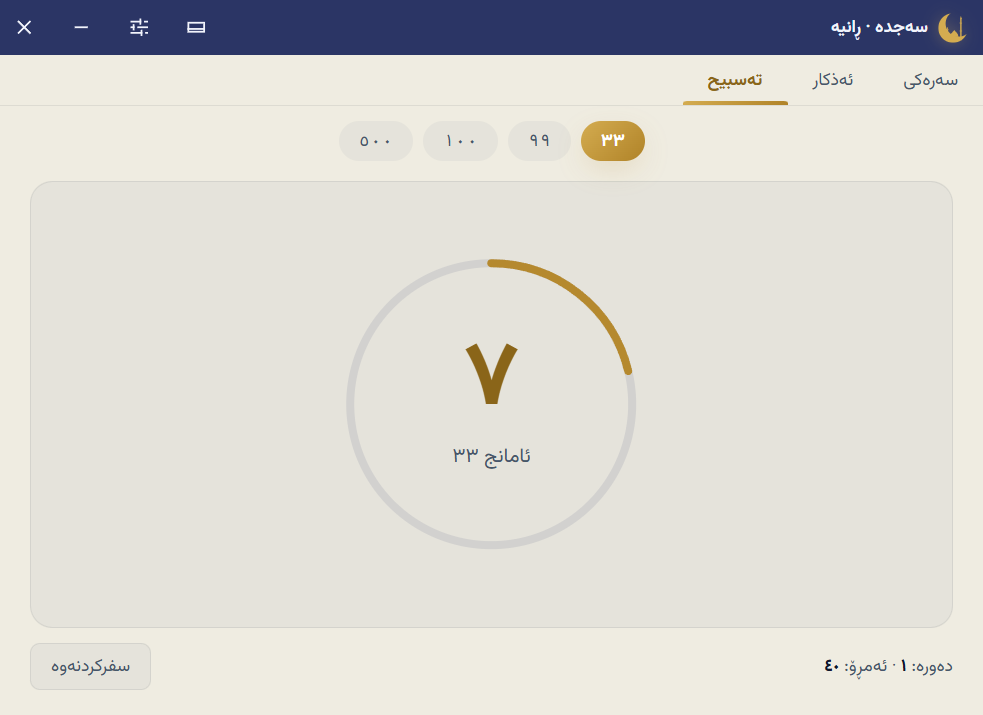
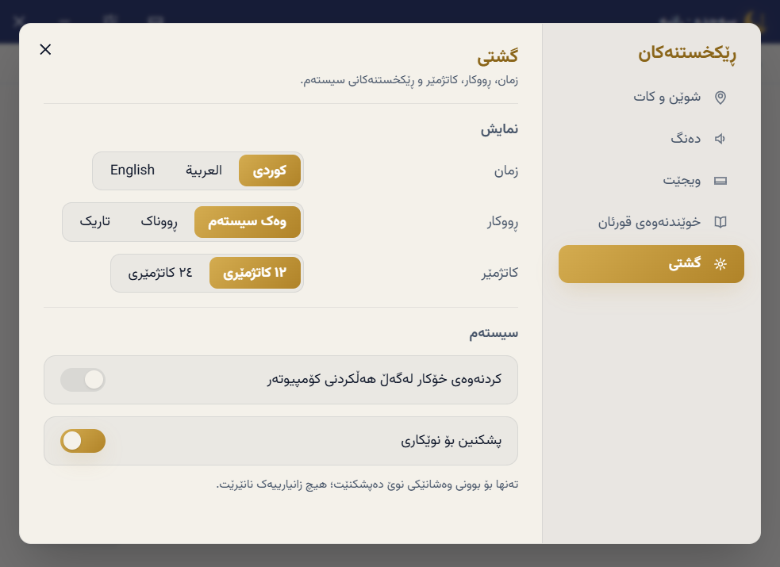
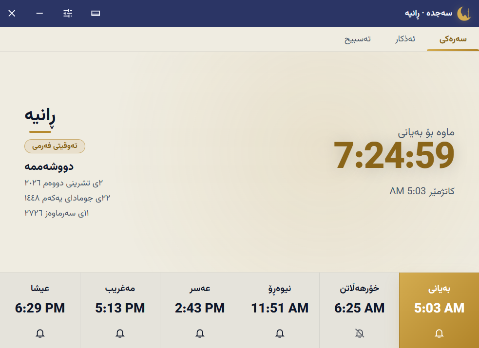

<p align="center">
  
</p>

<h1 align="center">Sajda · سەجدە</h1>

<p align="center">
  Prayer times, azkar, tasbih and a Quran reading lock — with an always-on-top desktop widget.<br>
  <strong>100% offline</strong>, in Kurdish (Sorani), Arabic and English. For Windows and macOS.
</p>

<p align="center">
  <a href="https://github.com/Hamoi1/sajda/releases/latest"></a>
  <a href="LICENSE"></a>
</p>

<p align="center">
  
</p>

---

## ✨ What Sajda does

Sajda counts down to the next prayer, tells you when it arrives, and keeps working even while its window is closed to the tray. Everything below runs without an internet connection.

### 🕌 Prayer times for anywhere on Earth

Times are calculated **on your machine** with the [adhan](https://github.com/batoulapps/adhan-js) library — no internet, no tables that expire, correct for **any date in any year**, past or future.

- **The Kurdistan convention, calibrated and default**: Fajr at 17°, Isha 80 minutes after Maghrib, and the official safety margins on Dhuhr, Asr and Maghrib — reproducing the region's published mosque schedules (verified against a full year of official tables: average deviation ≈ 3 minutes)
- **Eleven more methods**: Muslim World League, Umm al-Qura, Egyptian, Karachi, Dubai, Qatar, Kuwait, Moonsighting Committee, Turkey/Diyanet, Tehran, ISNA — with Shafi or Hanafi Asr
- Smart high-latitude handling; where a sun event genuinely cannot happen (midnight sun), that slot simply shows `--:--` while the rest keep working
- A −30…+30 minute adjustment per prayer, so the times match exactly what your mosque announces


### 🖥️ A widget you can make yours

<p align="center">
  
</p>

- **6 themes**: Indigo Night & Gold (the icon's own palette), Glass, Classic, Kilim, Minimal, Midnight
- **4 sizes**: small 224×92 · standard 300×116 · large 380×224 · **huge 480×304** with every prayer and the Hijri date
- Drag anywhere, lock in place, keep above other windows, fade the background 20–100%
- The slim gold progress line quietly shows how far you are into the current prayer window

<p align="center">
  
</p>

### 📿 Azkar (ئەذکار) — morning, evening, general

<p align="center">
  
</p>

Three collections — **بەیانیان** (morning), **ئێواران** (evening) and **گشتی** (general) — in clear Uthmani Arabic with their source (Al-Baqarah 255, Al-Bukhari, Muslim, Abu Dawud, Tirmidhi…). Tap a card to count its repetitions; finished cards glow gold. Progress resets automatically every day.

The Quran verses inside the azkar are byte-identical with the bundled Tanzil text, and the hadith texts follow the authentic collections.

### 📖 Quran reading lock (خوێندنەوەی قورئان)

<p align="center">
  
</p>

At the times you set — or a few minutes after the adhan — a fullscreen night-mushaf page opens **above everything** and reveals the surah ayah by ayah, with the basmala and gold ayah medallions. The window cannot be closed — not even with Alt+F4 — until the last ayah is read; then the gold **تەواوم کرد** button unlocks it. (A *Close Quran Reader* item stays in the tray as an emergency exit.)

- The **full Quran** (Uthmani text, Tanzil) is bundled — the lock works offline
- Choose a fixed surah, or let Sajda draw randomly from your own list (default: the short surahs of Juz 'Amma)

### 📲 Tasbih (تەسبیح)

<p align="center">
  
</p>

Targets ٣٣ / ٩٩ / ١٠٠ / ٥٠٠, cycle counting, a daily total, a soft tick on every tap and a chime when the ring completes. Tap, Space or Enter all count.

### 🔊 23 bundled adhan voices

Fourteen recitation styles, six full-length recordings, plus the Makkah, Abdulrahman and Peshawa adhans — all bundled, all offline. Pick one in **Settings → Sound → Adhan voice** and press Test.

### And everything else

- **Notifications**: a system notification at each prayer, optional reminder 5–30 minutes before, per-prayer mute buttons, tray *Stop Sound*
- **Three calendars**: Gregorian, Hijri, and the Kurdish solar calendar (نیسەن، بانەمەڕ، جۆزەردان… ڕەشەمە)
- **Tray-first design**: closing the window hides to the tray; open at login (on by default, configurable)
- **Light & dark themes** — both designed around the icon's indigo and gold — or follow the system
- **Three languages**: کوردی (default), العربية, English — full RTL
- **Update notices**: Sajda can check GitHub once a day for a newer release and tell you. That is its **only** network call, it sends nothing, and it can be turned off in Settings → General

<p align="center">
  
</p>

<p align="center">
  
</p>

---

## ⬇️ Download

Get the installer for your system from the [latest release](https://github.com/Hamoi1/sajda/releases/latest):

| System | File |
| --- | --- |
| Windows 10 / 11 | `Sajda_x.y.z_x64-setup.exe` or `.msi` |
| macOS, Apple Silicon (M1 and later) | `Sajda_x.y.z_aarch64.dmg` |
| macOS, Intel | `Sajda_x.y.z_x64.dmg` |

The installers are not code-signed yet. On Windows, SmartScreen may warn the first time: choose **More info**, then **Run anyway**. On macOS, right-click Sajda in Applications and choose **Open** the first time.

## 🎯 How the times work — for every year, everywhere

Sajda computes every prayer time locally from your coordinates with established astronomical formulas. The default **Kurdistan** preset was calibrated against a full year of the region's official mosque schedules, so its output matches what the mosques announce — for every city, not just the handful that publish tables. Nothing expires: the same calculation is exact for 2026, 2030 and 2040 alike, handles daylight-saving zones, leap days and the southern hemisphere, and stays silent about sun events that physically cannot happen (polar day and night).

Pick the convention your community follows (**Settings → Location & time**): twelve methods, Shafi or Hanafi Asr, and a fine adjustment of −30…+30 minutes per prayer.


## 🚀 Run it locally

You need [Node.js](https://nodejs.org) 20+, [Rust](https://rustup.rs) stable, and on Windows the VS 2022 Build Tools with *Desktop development with C++* (WebView2 ships with Windows) — on macOS, `xcode-select --install`.

```bash
git clone https://github.com/Hamoi1/sajda.git
cd sajda
npm install
npm run tauri dev
```

The first run compiles the Rust side and takes a few minutes; later runs start in seconds.

To work on the interface in a plain browser, run `npm run dev` and open <http://localhost:1420> — add `?widget` to preview the widget or `?reader` for the reading window. Tray, notifications and window controls only work in the desktop app.

### Build an installer

```bash
npm run tauri build
```

Installers land in `src-tauri/target/release/bundle/`.

### Useful scripts

| Command | What it does |
| --- | --- |
| `npm run tauri dev` | Runs the desktop app with live reload |
| `npm run build` | Typechecks and builds the interface into `dist/` |
| `npm run typecheck` | TypeScript check only |
| `npm run cities` | Rebuilds `src/data/world-cities.json` from `city-timezones` |
| `npm run quran` | Regenerates `src/data/quran.json` from the `quran-json` package |

## 🏷️ Releasing a new version

1. Set the version everywhere and commit it:

   ```bash
   npm run version:set -- 2.1.0
   git commit -am "chore: release v2.1.0"
   ```

2. Tag and push:

   ```bash
   git tag v2.1.0
   git push origin main v2.1.0
   ```

3. The **Release** workflow builds the Windows and macOS installers and publishes the release with notes and checksums. Nothing to click.

## 🧱 How it is built

- [Tauri 2](https://tauri.app) + Rust: windows, tray, notification scheduler, reading lock, start-at-login
- React 19, TypeScript, Vite, Tailwind CSS v4 for the interface
- [adhan](https://github.com/batoulapps/adhan-js) for astronomical prayer times, Zustand for settings
- Design language: [DESIGN.md](DESIGN.md)

The main window, the widget and the Quran reader are three separate webviews. Settings live in local storage; every change is announced with a Tauri event so the other windows update instantly. Exact prayer moments are handed to a tiny scheduler in Rust that fires on time even when every window is hidden.

```
src/
  windows/       MainWindow, WidgetWindow and the fullscreen ReaderWindow
  components/    title bar, tabs, prayer dock, azkar, tasbih, settings, widget card
  hooks/         prayer times, scheduling, window sync
  lib/           calculation, timetable lookup, translations, audio, themes, updates
  store/         settings store
  data/          cities, world cities, azkar, the Quran
src-tauri/
  src/lib.rs     tray, close-to-tray, reading lock, notification scheduler
  tauri.conf.json, capabilities/default.json
```

## 🔒 Privacy

Sajda collects nothing, sends nothing and has no accounts. All data — timetables, the Quran, azkar, voices — is bundled; your settings never leave the machine. The optional update check only asks GitHub whether a newer release exists.

## 🤝 Contributing

Sajda is open to everyone who wants to make it better — and there is a lot a single person can do:

- **Add official times for your city** (the most valuable thing you can contribute)
- Improve the کوردی / العربية / English wording
- Review the azkar texts and sources
- Add a widget theme or size, or polish the design
- Fix bugs, improve performance, help with code signing and the macOS build

The full guide — project map, data pipeline, PR checklist — is in [**CONTRIBUTING.md**](CONTRIBUTING.md).

## 🙏 Credits

- [adhan-js](https://github.com/batoulapps/adhan-js) by Batoul Apps, MIT
- [city-timezones](https://github.com/kevinroberts/city-timezones), MIT
- [Vazirmatn](https://github.com/rastikerdar/vazirmatn) by Saber Rastikerdar and [Noto Naskh Arabic](https://github.com/notofonts/arabic) by Google, SIL OFL 1.1
- Quran text from [Tanzil](https://tanzil.net) via the `quran-json` package
- Azkar texts follow Hisn al-Muslim and the authentic hadith collections

## 📄 License

[MIT](LICENSE) © 2026 Muhammad
