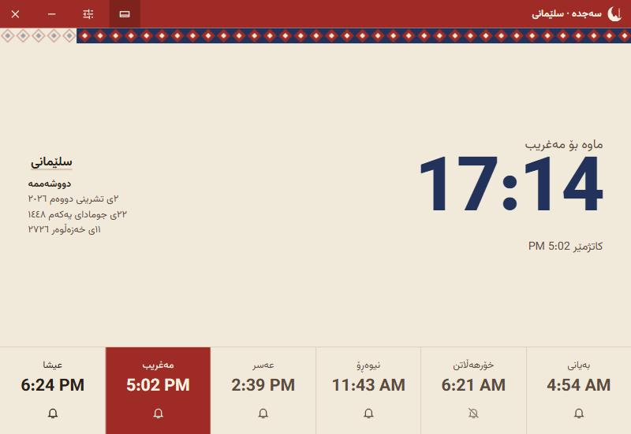
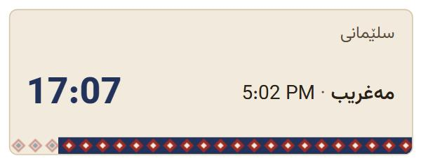

<p align="center">
  
</p>

<h1 align="center">Sajda · سەجدە</h1>

<p align="center">
  Prayer times and a small always-on-top widget for Windows and macOS.<br>
  Works offline, in Kurdish (Sorani), Arabic and English.
</p>

<p align="center">
  <a href="https://github.com/Hamoi1/sajda/releases/latest"></a>
  <a href="https://github.com/Hamoi1/sajda/actions/workflows/ci.yml"></a>
  <a href="LICENSE"></a>
</p>

<p align="center">
  
</p>

## What it does

Sajda counts down to the next prayer and tells you when it arrives, even while its window is closed to the tray.

- **Six times a day:** Fajr, Sunrise, Dhuhr, Asr, Maghrib and Isha, calculated on your computer with the [adhan](https://github.com/batoulapps/adhan-js) library. No internet connection or account.
- **Matches your mosque:** eleven calculation methods (Muslim World League, Umm al-Qura, Egyptian, Karachi, Dubai, Qatar, Kuwait, Moonsighting Committee, Turkey, Tehran, ISNA), Shafi or Hanafi Asr, and a minute adjustment from -30 to +30 for each prayer.
- **Cities:** more than 80 hand-entered places across Kurdistan and Iraq with Kurdish and Arabic names, about 7,200 world cities you can search, and custom coordinates with any time zone.
- **Desktop widget:** a 300 × 116 frameless card you can drag anywhere, lock in place, keep above other windows and fade from 20% to 100% background opacity.
- **Notifications and sound:** a system notification at each prayer, an optional reminder 5 to 30 minutes before, and a full adhan or a short chime. Each prayer has its own mute button.
- **Three calendars:** Gregorian, Hijri (Umm al-Qura) and, in Kurdish, the Kurdish solar calendar (for example ١١ی خەزەڵوەر ٢٧٢٦).
- **Stays out of the way:** closing the window keeps Sajda in the system tray, and it can start with your computer.
- **Light and dark themes**, or follow the system setting.

<p align="center">
  
</p>

## Download

Get the installer for your system from the [latest release](https://github.com/Hamoi1/sajda/releases/latest):

| System | File |
| --- | --- |
| Windows 10 / 11 | `Sajda_x.y.z_x64-setup.exe` or `.msi` |
| macOS, Apple Silicon (M1 and later) | `Sajda_x.y.z_aarch64.dmg` |
| macOS, Intel | `Sajda_x.y.z_x64.dmg` |

The installers are not code-signed yet. On Windows, SmartScreen may warn the first time: choose **More info**, then **Run anyway**. On macOS, right-click Sajda in Applications and choose **Open** the first time.

## How accurate are the times?

Sajda uses standard astronomical formulas. For Sulaymaniyah on 2 November 2026 with the Muslim World League method, its times match the [AlAdhan API](https://aladhan.com/prayer-times-api) to within one minute (the library adds a one-minute safety margin to Dhuhr and rounds to the nearest minute).

Mosques and ministries often publish their own tables, which can differ by a few minutes from any formula. If your mosque's times differ, open **Settings → Calculation** and adjust each prayer by the difference. The adjustment is saved.

## Adding the adhan recording

Sajda does not ship an adhan recording. To use your own, put an MP3 file at:

```
public/audio/adhan.mp3
```

and build the app again. Until that file exists, the **Full adhan** option plays the short chime instead, and the settings screen says so.

## Run it locally

You need:

- [Node.js](https://nodejs.org) 20 or newer
- [Rust](https://rustup.rs) (stable)
- Windows: Visual Studio 2022 Build Tools with **Desktop development with C++**, and WebView2 (already part of Windows 10 and 11)
- macOS: Xcode Command Line Tools (`xcode-select --install`)

Then:

```bash
git clone https://github.com/Hamoi1/sajda.git
cd sajda
npm install
npm run tauri dev
```

The first run compiles the Rust side and takes a few minutes; later runs start in seconds.

To work on the interface in a normal browser without Tauri, run `npm run dev` and open <http://localhost:1420>. Add `?widget` to the address to see the widget. Notifications, the tray and window controls only work in the desktop app.

### Build an installer on your own machine

```bash
npm run tauri build
```

The installers are written to `src-tauri/target/release/bundle/`.

### Useful scripts

| Command | What it does |
| --- | --- |
| `npm run tauri dev` | Runs the desktop app with live reload |
| `npm run build` | Typechecks and builds the interface into `dist/` |
| `npm run typecheck` | TypeScript check only |
| `npm run cities` | Rebuilds `src/data/world-cities.json` from the `city-timezones` package |

## Releasing a new version

1. Change `version` in `src-tauri/tauri.conf.json`, `src-tauri/Cargo.toml` and `package.json`.
2. Commit, then tag and push:

   ```bash
   git tag v1.0.0
   git push origin v1.0.0
   ```

3. The **Release** workflow builds Windows and macOS installers and attaches them to a draft release. Check the draft on GitHub, then publish it.

Every push and pull request also runs the **CI** workflow: TypeScript check, interface build, `cargo fmt` and `cargo clippy` on Windows and macOS.

## How it is built

- [Tauri 2](https://tauri.app) and Rust for the window, tray, notifications and start-at-login
- React 19, TypeScript and Vite for the interface, styled with Tailwind CSS
- [adhan](https://github.com/batoulapps/adhan-js) for prayer times, Zustand for settings

The main window and the widget are two separate webviews. Settings are saved in local storage and each change is announced with a Tauri event, so the other window updates at once. The exact prayer moments are handed to a small scheduler in Rust, which fires the notification on time even when both windows are hidden.

```
src/
  windows/       MainWindow and WidgetWindow
  components/    title bar, prayer row, settings, kilim band, icons
  hooks/         prayer times, scheduling, window sync
  lib/           calculation, translations, audio, Tauri helpers
  store/         settings store
  data/          cities.json (curated) and world-cities.json (generated)
src-tauri/
  src/lib.rs     tray, close-to-tray and notification scheduler
  tauri.conf.json, capabilities/default.json
```

## Credits

- [adhan-js](https://github.com/batoulapps/adhan-js) by Batoul Apps, MIT license
- [city-timezones](https://github.com/kevinroberts/city-timezones), MIT license
- [Vazirmatn](https://github.com/rastikerdar/vazirmatn) font by Saber Rastikerdar, SIL Open Font License 1.1

## License

[MIT](LICENSE) © 2026 Muhammad
